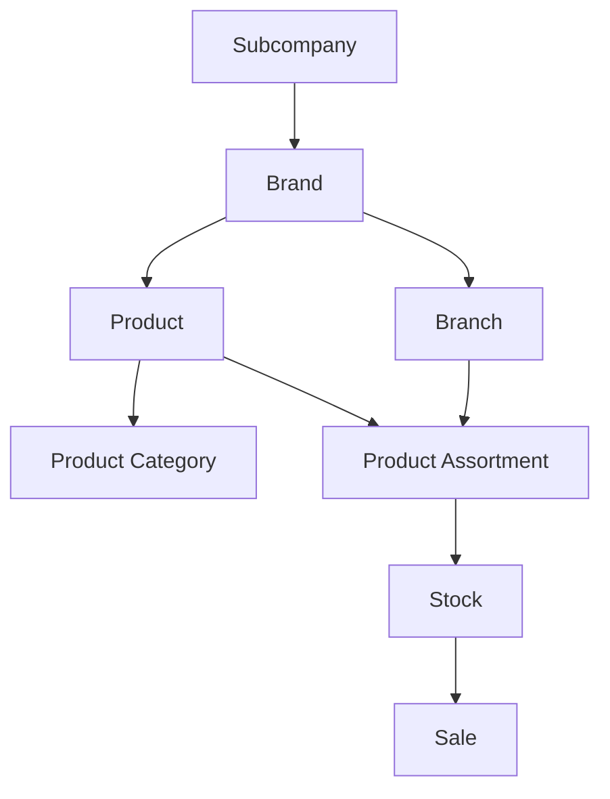

<div align="center">

# 🏪 Retail Management System

### A FastAPI-based retail operations management platform

Manage products, brands, branches, assortments, stock movements, and sales transactions while enforcing business rules across the retail ecosystem.


</div>

---

# 📚 Table of Contents

* [Overview](#-overview)
* [Features](#-features)
* [Business Rules](#-business-rules)
* [Architecture](#-architecture)
* [Design Patterns](#-design-patterns)
* [Domain Model](#-domain-model)
* [Technology Stack](#-technology-stack)
* [API Overview](#-api-overview)
* [Project Structure](#-project-structure)
* [Running the Project](#-running-the-project)

---

# 🎯 Overview

Retail Management System is a backend application developed with FastAPI and PostgreSQL for managing retail operations across multiple brands and branches.

The system currently supports:

* Product Management
* Product Categories
* Brand Management
* Branch Management
* Subcompany Management
* Product Assortment Management
* Stock Management
* Sales Transactions
* Brand Reassignment Operations

The architecture follows Clean Architecture principles to keep business rules independent from frameworks and infrastructure concerns.

---

# 🚀 Features

## Product Management

* Create products
* Retrieve products
* Manage product categories

## Organization Management

* Brand management
* Branch management
* Subcompany management
* Brand reassignment functionality

## Inventory Management

* Product assortment control
* Stock quantity management
* Inventory validation

## Sales Management

* Sales transaction processing
* Automatic stock deduction
* Business rule validation before sale

---

# 📋 Business Rules

The system enforces domain-level business constraints:

### Product Ownership Rule

A product can only be sold within branches belonging to the same brand.

### Assortment Rule

A product can only be added to assortments of branches belonging to its own brand.

### Stock Validation Rule

A sale cannot be completed if the requested quantity exceeds available stock.

### Inventory Consistency Rule

Successful sales automatically decrease stock quantities.

---

# 🏗️ Architecture

The project follows **Clean Architecture**.

```text
Presentation Layer
        │
        ▼
Application Layer
        │
        ▼
Domain Layer
        ▲
        │
Infrastructure Layer
```

### Benefits

* Clear separation of concerns
* Maintainable codebase
* Framework-independent business logic
* Easier testing and extension

---

# 🎨 Design Patterns

### Strategy Pattern

Used to encapsulate interchangeable business behaviors and validation logic.

### Facade Pattern

Used to simplify database interactions and infrastructure operations.

### Mediator Pattern

Used to coordinate communication between application components while reducing coupling.

---

# 🧩 Domain Model



---

# ⚙️ Technology Stack

| Category         | Technology         |
| ---------------- | ------------------ |
| Language         | Python             |
| Framework        | FastAPI            |
| Database         | PostgreSQL         |
| ORM              | SQLAlchemy         |
| Migrations       | Alembic            |
| Containerization | Docker             |
| Orchestration    | Docker Compose     |
| Documentation    | Swagger UI / ReDoc |

---

# 🌐 API Overview

The project currently exposes approximately **14 REST API endpoints**.

Covered modules:

* Products
* Product Categories
* Brands
* Branches
* Subcompanies
* Product Assortments
* Stocks
* Sales

FastAPI automatically generates:

* Swagger UI (`/docs`)
* ReDoc (`/redoc`)

---

# 📂 Project Structure

```text
app/
│
├── domain/
│   ├── entities/
│   ├── repositories/
│
├── application/
│   ├── use_cases/
│   ├── services/
│
├── infrastructure/
│   ├── database/
│   ├── repositories/
│   └── services/
│
├── presentation/
│   ├── api/
│       ├── v1/
|           ├── routes/
│           └── schemas/
│
├── core/
│
└── main.py
```

---

# 🐳 Running the Project

## Build Containers

```bash
docker compose build
```

## Start Application

```bash
docker compose up
```

## Generate Migration

```bash
docker compose exec api alembic revision --autogenerate -m "migration_name"
```

## Apply Migration

```bash
docker compose exec api alembic upgrade head
```

---

# 🗄️ Database Entities

* Product
* ProductCategory
* Brand
* Branch
* Subcompany
* ProductAssortment
* Stock
* Sale

Database schema changes are managed using Alembic migrations.

---

<div align="center">

### Built with FastAPI, PostgreSQL, SQLAlchemy and Clean Architecture

</div>
